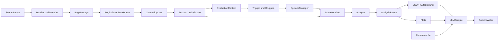

# Coding Principles für die Scene Pipeline

## Zweck und Geltungsbereich

Dieses Dokument ist der gemeinsame Leitfaden für zukünftige Erweiterungen
dieses Projekts. Die vorhandene modulare Pipeline ist die Referenz: Neue
Funktionen sollen ihre Struktur fortführen und sich in ihre Schnittstellen
einfügen. Eine Erweiterung ist kein Anlass, die bestehende Architektur durch
ein neues Framework oder eine parallele Pipeline zu ersetzen.

Die ursprünglichen Anforderungen bleiben maßgeblich:

> Jedes Modul hat eine klare Aufgabe. Der Code bleibt einfach, strukturiert
> und verständlich. Funktionen werden aus kleinen, klar benannten Schritten
> aufgebaut. Tiefe Verschachtlungen sind zu vermeiden. Jede Funktion und
> Klasse dokumentiert ihre Schnittstelle. Neue Extraktoren und Trigger
> lassen sich nachvollziehbar in den bestehenden Datenfluss einbinden.

**Keep it simple:** Eine Person soll eine Funktion lesen können und dabei
verstehen, welche Daten hineingehen, was geprüft oder verändert wird und
welches Ergebnis herauskommt.

Dieser Leitfaden beschreibt Regeln für neue Beiträge. Er behauptet nicht,
dass jede bestehende Zeile bereits jede Empfehlung vollständig erfüllt.
Bestehenden Code nicht ungefragt allein zur Stilangleichung umschreiben.

Weiterführende Dokumentation:

- [README.md](README.md): Ausführung und Einstieg.
- [ARCHITEKTUR.md](ARCHITEKTUR.md): Architektur und vollständiger Ablauf.
- [analysis/analyze.md](analysis/analyze.md): Relevanzanalyse Schritt für Schritt.

## 1. Die wichtigsten Regeln

1. **Eine klare Verantwortung pro Modul und Funktion.**
2. **Lesbare kleine Schritte statt tiefer Verschachtlung.**
3. **Explizite Eingaben, Ergebnisse und Abhängigkeiten.**
4. **Dokumentierte Schnittstellen mit Argumenten und Rückgaben.**
5. **Gemeinsame Datenverträge statt mehrfacher Datenumwandlung.**
6. **Neue Extraktoren über die Registry, neue Regeln über Triggergruppen einbinden.**
7. **Fachliche Schwellenwerte über validierte Konfiguration einstellen.**
8. **Extraktion, Zustand, Trigger, Analyse und Darstellung getrennt halten.**
9. **Vorhandene Information teilen; große numerische Daten als Arrays verarbeiten.**
10. **Zeit, Koordinatensystem und unbekannte Werte ausdrücklich behandeln.**
11. **Bestehende Daten und Dateien erhalten; Änderungen auf den Auftrag begrenzen.**
12. **Verhalten gezielt prüfen und fachliche Grenzen offen dokumentieren.**

## 2. Vor dem Programmieren einen konkreten Plan erstellen

Vor einer neuen fachlichen Erweiterung werden diese Fragen beantwortet:

| Frage | Erwartete Antwort |
|---|---|
| Welches Problem wird gelöst? | Ein konkreter Anwendungsfall mit erwartetem Verhalten. |
| Wo gehört die Funktion hin? | Bestehender Fachordner oder begründetes neues Modul. |
| Welche Dateien ändern sich? | Kleine, konkrete Liste einschließlich neuer Dateien. |
| Welche Daten werden benötigt? | Eingabetypen, Kanäle, Zeitstempel, Einheiten und Frames. |
| Was kommt zurück? | Rückgabetyp und genaue Bedeutung der Werte. |
| Welche Abhängigkeiten entstehen? | Aufgerufene Dienste und importierte Module. |
| Welche Parameter sind einstellbar? | Namen, Einheiten, Standardwerte und zulässige Bereiche. |
| Wie wird die Erweiterung eingebunden? | Registry, Triggergruppe, Analyseaufruf oder Ausgabe. |
| Woran erkennt man korrektes Verhalten? | Konkrete Beispiele und relevante Grenzfälle. |

Bei größeren Architektur- oder Schnittstellenänderungen wird der Konzeptplan
zuerst im Chat beschrieben und entsprechend dem Auftrag bestätigt. Ist die
konkrete Umsetzung bereits autorisiert, sind gewöhnliche Implementierungsdetails
kein Anlass für wiederholte Bestätigungsfragen. Ein ausdrücklicher Auftrag
„erst analysieren, nichts ändern“ bleibt dagegen eine klare Grenze.

Vorhandenen Code und die betroffenen Aufrufer lesen, bevor eine neue Lösung
entsteht. Keine bereits vorhandene Funktion mit anderem Namen duplizieren.

## 3. Jedes Modul besitzt eine fachliche Aufgabe

Die Aufgabe eines Moduls muss sich in einem verständlichen Satz ausdrücken lassen.
Ein Modul darf mehrere Funktionen enthalten, wenn diese gemeinsam seine Aufgabe
erfüllen. Nicht jede Hilfsfunktion braucht eine eigene Datei.

| Ort | Verantwortung | Gehört nicht hierher |
|---|---|---|
| `io/scene_loader.py` | Szenennamen und Dateipfade auflösen. | Objekte bewerten. |
| `io/bag_reader.py` | Ausgewählte Nachrichten chronologisch lesen. | Triggerlogik und Plotfarben. |
| `io/ros_decoder.py` | Gespeicherte Daten in ROS-Nachrichten decodieren. | Fachliche Relevanzauswahl. |
| `io/camera.py` | Kamerabilder puffern, auswählen und decodieren; Kalibrierung extrahieren. | LLM-Entscheidungen treffen. |
| `extraction/` | ROS-Felder in definierte interne Datenkanäle übertragen. | Episoden auslösen oder Objekte als irrelevant löschen. |
| `state/` | Zustand, Historie, Beobachtungsfenster und gemeinsame Geometrie bereitstellen. | Exportdateien schreiben. |
| `trigger/` | Auslösebedingungen und deren zeitliche Bestätigung behandeln. | JSON formatieren oder Plots erstellen. |
| `analysis/` | Entscheidungskontext, Relevanz und fachliche Belege bestimmen. | ROS-Dateien selbst öffnen oder Ausgaben schreiben. |
| `output/` | Analyse in JSON, Plots und Exportdateien überführen. | Trigger erneut auswerten. |
| `config.py` | Hyperparameter und ihre Validierung definieren. | Laufenden Szenenzustand speichern. |
| `types.py` | Gemeinsame Übergabetypen beschreiben. | Konkrete Reader, Plotter oder Trigger instanziieren. |
| `interfaces.py` | Kleine Erweiterungsverträge definieren. | Automatisch Plugins suchen oder registrieren. |
| `pipeline.py` | Dienste zusammenstellen und den Ablauf steuern. | Fachalgorithmen aller Module aufnehmen. |
| `demo_scenes.py`, `__main__.py` | Konfiguration und Ausführung für Nutzer bereitstellen. | Eine zweite Implementierung der Pipeline enthalten. |
| `src/utils/` | Fachunabhängige, wiederverwendbare Hilfsfunktionen bereitstellen. | Beliebige schwer zuzuordnende Fachlogik sammeln. |

Beispiele für die richtige Einordnung:

- `positive()` ist eine allgemeine Zahlenprüfung und liegt in
  [utils/validation.py](../utils/validation.py).
- `describe_rule()` kennt Trigger und liegt in
  [trigger/serialization.py](trigger/serialization.py).
- `corridor_polygons()` erzeugt Darstellungsgeometrie und liegt in
  [output/plot_geometry.py](output/plot_geometry.py).
- ROS-spezifische Feldkonvertierungen bleiben in `extraction/helpers.py`.

Keine Sammeldateien wie `misc.py` oder `helpers.py` für fachlich unabhängige
Aufgaben anlegen. Auch bei Hilfsmodulen muss die Zuständigkeit erkennbar sein.

## 4. Den gemeinsamen Datenfluss beibehalten



Dieser Graph zeigt fachlichen Datenfluss, nicht die vollständige Importstruktur.
Die genaue Ablaufsteuerung steht in `pipeline.py`.

Neue Information soll über einen definierten Kanal in den gemeinsamen Zustand
gelangen. Kein zweiter globaler Datenspeicher nur für einen neuen Trigger.
Ein Analysemodul soll nicht selbst erneut den Bag lesen, wenn der benötigte
Kanal bereits bereitgestellt werden kann.

Die Verarbeitung nutzt dieselben Daten weiter:

```text
einmal lesen und decodieren
→ fachlich extrahieren
→ gemeinsam bereitstellen
→ für unterschiedliche Prüfungen verwenden
```

## 5. Funktionen aus kleinen, benannten Schritten aufbauen

### Eine Funktion beantwortet eine konkrete Frage

Gute Aufgaben sind beispielsweise:

- „Welche Objektzentren liegen im Sektor?“
- „Welche Transformation verbindet diese beiden Frames?“
- „Welches Bild war zum Entscheidungszeitpunkt verfügbar?“
- „Welche Farbe hat dieses Objekt gemäß dem Analyseergebnis?“

„Alle Daten verarbeiten“ ist für eine fachliche Hilfsfunktion zu ungenau.

### Frühe Rückgaben statt tiefer Verschachtlung

Bevorzugte Form:

```python
item = context.state.get("roadworks.status", max_age_s=config.max_age_s)
if item is None:
    return TriggerResult("roadworks", "unknown")

status = "true" if item.data["active"] else "false"
return TriggerResult("roadworks", status)
```

Nach der Behandlung fehlender Daten läuft der normale Pfad auf einer flachen
Einrückungsebene weiter. Keine langen Ketten aus `if`, `else`, Schleifen und
`try`, in denen der eigentliche Zweck kaum noch sichtbar ist.

Schleifen und Verzweigungen sind erlaubt, wenn die Aufgabe sie braucht.
Entscheidend ist Lesbarkeit, nicht ein starres Verbot jeder Verschachtlung.
Wird eine Funktion schwer überblickbar, einen sinnvoll benennbaren Teilschritt
auslagern. Keine künstlichen Einzeiler-Funktionen ohne eigenen Bedeutungsgehalt.

### Zwischenwerte fachlich benennen

```python
inside_sector = sector_mask(position, opening_angle_deg, radius_m)
slow_enough = speed <= max_stationary_speed_mps
candidates = valid & inside_sector & slow_enough
```

Das ist leichter prüfbar als eine einzige lange Formel mit mehrfachen
Unterausdrücken. Bei NumPy die elementweisen Operatoren `&`, `|` und `~`
verwenden und Vergleiche ausreichend klammern.

### Keine versteckten Nebenwirkungen

Eine Prüffunktion soll nicht nebenbei Dateien speichern, globale Einstellungen
ändern oder den gemeinsamen Objektbestand verändern. Ist Zustandsänderung
die Aufgabe, muss das erkennbar sein: `StateStore.update()` oder
`WindowBuffer.append()` dürfen ihren ausdrücklich verwalteten Zustand ändern.

## 6. Klassen gezielt verwenden

Klassen sind sinnvoll für:

- Dienste mit Konfiguration, beispielsweise einen Trigger oder Plotter;
- ausdrücklich verwalteten Zustand, beispielsweise Historie und Kamerapuffer;
- zusammengehörige Übergabedaten, beispielsweise `ObjectBatch`;
- austauschbare Anbieter mit gemeinsamer Schnittstelle.

Reine Berechnungen dürfen freie Funktionen bleiben. Eine Koordinatenumrechnung
braucht keine Klasse ohne eigenen Zustand.

**Komposition ist der Standard:** `ScenePipeline` erhält beziehungsweise
erstellt spezialisierte Dienste und ruft sie auf. Keine tiefe Basisklassen-
Hierarchie für Reader, Extraktoren, Trigger und Ausgabe entwickeln.

`Protocol` beschreibt benötigte Methoden und Attribute. Ein neuer Extraktor
muss nicht von einer konkreten gemeinsamen Basisklasse erben, wenn er den
Vertrag erfüllt.

Konstruktoren speichern Abhängigkeiten, validieren Konfiguration und bereiten
den Dienst vor. Sie sollen nicht unerwartet die gesamte Aufnahme verarbeiten,
Netzwerkanfragen senden oder einen Browser öffnen.

## 7. Schnittstellen ausdrücklich definieren

Vor der Implementierung einer Funktion festlegen:

1. Namen und Typen der Argumente.
2. Bedeutung, Einheiten und zulässige Werte.
3. Rückgabetyp und Form des Ergebnisses.
4. Bedeutung leerer Ergebnisse und unbekannter Werte.
5. Mögliche Zustandsänderungen und Fehler.

Öffentliche Schnittstellen mit Typannotationen versehen. Für stabile gemeinsame
Strukturen die Typen aus [types.py](types.py) verwenden. `Any` nur dort einsetzen,
wo tatsächlich variable Daten auftreten, etwa bei decodierten ROS-Payloads.

Keine kontextabhängigen Rückgaben wie „manchmal Liste, manchmal Dictionary,
manchmal False“. Ein optionales Ergebnis ausdrücklich als `T | None`
beschreiben. Ein Generator dokumentiert seine Elemente unter `Yields`.

Nicht jede kleine Fachstruktur muss sofort ein neuer gemeinsamer Datentyp
werden. Ein kleines dokumentiertes Dictionary kann für Kanalnutzdaten
ausreichen. Sobald mehrere Verbraucher einen festen komplexeren Vertrag
benötigen, ist ein benannter Typ zu bevorzugen.

### Abhängigkeiten sichtbar halten

- Benötigte Dienste über Konstruktor oder Funktionsargument übergeben.
- Keine globalen Service-Lookups in Fachfunktionen.
- Keine zyklischen Imports.
- Einzelne Trigger importieren nicht `trigger/base.py`; dieses Modul setzt
  die Regeln zusammen.
- Reader und Extraktoren benötigen keine Ausgabe- oder Plotmodule.
- Reine Geometrie darf von Zustand, Triggern und Analyse gemeinsam verwendet werden.
- Gemeinsame Typen und allgemeine Utilities hängen nicht von konkreten Diensten ab.

## 8. Jede Funktion und Klasse dokumentieren

Jedes neue Modul erhält einen kurzen Moduldocstring. Jede Klasse und jede
Funktion erhält einen Docstring, auch private Hilfsfunktionen und Konstruktoren.

Die bestehende Konvention lautet:

- Englische Bezeichner und vorzugsweise englische Code-Docstrings.
- Deutsche Projekterklärungen und nutzerbezogene Beschreibungen.
- `Args`, `Returns`, bei Bedarf `Yields`, `Raises` und `Attributes`.

Vorhandene kompakte Docstrings dürfen kompakt bleiben. Neue Beschreibungen
sollen vollständig sein, ohne die Implementierung Zeile für Zeile zu wiederholen.

### Beispiel für eine numerische Funktion

```python
import numpy as np


def distances_xy(position: np.ndarray) -> np.ndarray:
    """Measure object-centre distances from the ego pose reference.

    Args:
        position: Ego-relative coordinates with shape (N, 3), in metres.

    Returns:
        XY distance magnitudes with shape (N,), in metres.
        Invalid input coordinates propagate as nonfinite distances.
    """
    return np.linalg.norm(position[:, :2], axis=1)
```

### Für Klassen dokumentieren

- Welche Verantwortung hat die Klasse?
- Welche Argumente akzeptiert ihr Konstruktor?
- Welche öffentlichen Attribute gehören zum Vertrag?
- Welchen Zustand besitzt sie gegebenenfalls?

Eine Klasse selbst hat keinen Funktionsrückgabewert. Statt einen künstlichen
`Returns`-Abschnitt an die Klasse zu hängen, dokumentiert der Konstruktor
`Returns: None`, und jede Methode dokumentiert ihr tatsächliches Ergebnis.
Bei Dataclasses werden die Felder unter `Args` beschrieben.

Bei parameterlosen Funktionen `Args: None` angeben, wenn dies Klarheit schafft.
`self` muss nicht wie ein Nutzereingabeparameter erklärt werden. Bei Generatoren
ersetzt `Yields` die Beschreibung eines normalen Rückgabewerts.

Kommentare erklären Annahmen und Gründe. Sie ersetzen weder verständliche
Namen noch den Docstring der Schnittstelle.

## 9. Datenverträge, Einheiten und NumPy

### Einheiten gehören zur Bedeutung der Daten

| Größe | Konvention |
|---|---|
| Position, Abstand, Radius | Meter; Namen möglichst mit `_m`. |
| Geschwindigkeit | Meter pro Sekunde; `_mps`. |
| Dauer | Sekunden; `_s`. |
| Absolute und präzise relative Zeit | Ganzzahlige Nanosekunden; `_ns`. |
| Konfigurierter Sektorwinkel | Grad; `_deg`, gesamter Öffnungswinkel. |
| Geometrischer Yaw-Winkel | Radiant; `_rad`, wenn nicht bereits eindeutig dokumentiert. |
| Quaternion | Komponentenreihenfolge XYZW. |
| Ego-relative XY-Position | X vorwärts, Y links. |

Ein Abstand muss seinen Bezug erklären: Objektzentrum, Objektoberfläche,
Haltelinie oder Entfernung entlang des Pfads sind unterschiedliche Größen.

### Arrays statt eines Python-Objekts pro Punkt

Numerische Beobachtungen in zusammenhängenden NumPy-Arrays verarbeiten.
Objektpositionen beispielsweise als `(N, 3)`, Gültigkeit als `(N,)`-Maske.

Ein gemeinsamer Zeilenindex muss in allen zugehörigen Arrays dasselbe Objekt
bezeichnen. Beim Filtern, Sortieren oder Erzeugen neuer Merkmale diese
Ausrichtung erhalten. Volle Track-IDs bleiben die Identität; kurze `O1`-IDs
sind nur samplelokale Ausgabenamen.

Unterschiedlich lange Prognosen oder Footprints können über flache Arrays
mit Offsets dargestellt werden. Die Bedeutung der Offsets und Besitzerindizes
gehört in den Datenvertrag.

### Geteilte Daten nicht unbemerkt verändern

Extrahierte Arrays sind im bestehenden Aufbau schreibgeschützt.
Gemeinsam genutzte Payloads nicht nachträglich verändern. Für veränderte Daten
ausdrücklich ein neues Ergebnis erzeugen.

`frozen=True` schützt Dataclass-Felder vor Neuzuweisung. Es macht enthaltene
Dictionaries nicht automatisch tief unveränderlich. Diese Unterscheidung
bei neuen Datenstrukturen berücksichtigen.

Relevanzmasken entfernen keine Daten aus dem ursprünglichen `ObjectBatch`.
Die Auswahl gehört in das Analyseergebnis und dessen Verbraucher.

## 10. Neue Extraktoren hinzufügen

Ein Extraktor erledigt genau eine fachliche Übertragung: ROS-Nachrichtenfelder
werden in einen oder mehrere klar benannte interne Kanäle übersetzt.

Der Vertrag aus [interfaces.py](interfaces.py) lautet:

```python
topics: tuple[str, ...]
provides: tuple[str, ...]

def extract(message: BagMessage) -> tuple[ChannelUpdate, ...]:
    ...
```

Vorgehen:

1. Tatsächliches ROS-Topic und Nachrichtenschema prüfen.
2. Benötigte Felder, Quellzeit, Frame und Bedeutung leerer Nachrichten festlegen.
3. Fachlich passenden Kanalnamen wählen, beispielsweise `roadworks.status`.
4. Payload und Schnittstelle dokumentieren.
5. Extraktor in `extraction/` implementieren.
6. In `default_registry()` oder einer ausdrücklich übergebenen Registry registrieren.
7. Verbraucher und notwendige Tests ergänzen.

Pro Kanal gibt es genau einen registrierten Produzenten. Mehrere Extraktoren
dürfen dasselbe Topic konsumieren, wenn sie unterschiedliche Kanäle erzeugen.

`ChannelUpdate` erhält Herkunft, Aufnahmezeit, Quellzeit und Koordinatenrahmen.
Geometrische Daten ohne geeignete Zeit- oder Frameinformationen nicht durch
geratene Standardwerte scheinbar gültig machen. Persistenz nur für tatsächlich
persistenten Kontext deklarieren, nicht um Frischeprüfungen zu umgehen.

### Was automatisch verfügbar wird und was ausdrücklich ergänzt werden muss

Ein registrierter Kanal gelangt in den gemeinsamen Zustand und in aktive
Beobachtungsfenster. Ein Trigger kann ihn über `context.state.get(...)` lesen.
Eine Analyse kann ihn über denselben Zustand verwenden.

Die Registrierung erzeugt **keine automatische Fachinterpretation**:

- Neue Trigger müssen den Kanal bewusst auswerten.
- Neue Analyseergebnisse müssen bewusst berechnet werden.
- Zusätzliche JSON-Felder benötigen eine Ergänzung von Builder und Schema.
- Neue Grafikelemente benötigen eine entsprechende Darstellung.
- Besondere Ereignissemantik, etwa das Zusammenführen von Teilupdates, benötigt
  eine ausdrücklich definierte Zustandsbehandlung.

Eine selbst übergebene Registry muss auch ihre sonstigen gewünschten Produzenten
enthalten. Beispielsweise wird der Kamera-Kalibrierungsextraktor nur beim
standardmäßigen Registry-Aufbau durch `ScenePipeline` automatisch ergänzt.

## 11. Neue Trigger und Hyperparameter hinzufügen

### Eine Regel prüft eine Bedingung

Beispiele sind „Fahrzeug steht im vorderen Sektor“ oder „hinter dem Anker
befinden sich mindestens zwei weitere langsame Fahrzeuge“.

Der Vertrag lautet:

```python
name: str
requires: tuple[str, ...]

def evaluate(context: EvaluationContext) -> TriggerResult:
    ...
```

Regeln erhalten gemeinsame Daten, statt selbst ROS-Nachrichten einzulesen.
Sie enthalten keine eigenen Fünf-Sekunden-Schleifen und erzeugen keine Samples.
Die zeitliche Bestätigung gehört dem `EpisodeManager`.

### Hyperparameter in Konfiguration bündeln

Jeder konfigurierbare Trigger erhält eine eigene, möglichst unveränderliche
Konfigurationsklasse. Dazu gehören beispielsweise:

- Öffnungswinkel und Radius;
- Mindest- und Höchstabstände;
- Geschwindigkeitsschwellen;
- beobachtete Mindestdauer;
- Mindestanzahl weiterer Fahrzeuge;
- zulässiges Datenalter.

Keine versteckten Zahlen in `evaluate()`, die die Auslösesensitivität bestimmen.
Parameter beim Erstellen validieren, einschließlich Beziehungen zwischen Werten.
Für NaN, Unendlich, negative Radien oder unzulässige Zählwerte früh verständliche
Fehler auslösen.

Standardwerte in `config.py` definieren. Falls YAML oder CLI die neuen Werte
setzen sollen, deren explizite Zuordnung ebenfalls ergänzen. Das Beispiels-YAML
ist eine dokumentierte Konfiguration und muss mit den beabsichtigten Defaults
konsistent gehalten werden.

### Initialisierung und logische Verknüpfung in `trigger/base.py`

Einzelne Triggerdateien beschreiben ihre eigene Regel. `build_trigger_groups`
erstellt die Instanzen mit den konfigurierten Hyperparametern und verbindet sie.
Beispiel mit vorhandenen Klassen, innerhalb dieser Zusammensetzung:

```python
stopped = StoppedVehicleAheadTrigger(config.stopped)
queue = VehicleQueueTrigger(config.queue)

group = TriggerGroup(
    name="stopped_vehicle_with_queue",
    operator="all",
    triggers=(stopped, queue),
    require_same_anchor=True,
)
```

`queue.enabled` wird bei der Entscheidung berücksichtigt, ob diese Gruppe
anstelle der einfachen Stillstandsgruppe verwendet wird. Das Beispiel zeigt
die Zusammensetzung, keine automatische Aktivierung einer optionalen Regel.

Keine AND-/OR-Verknüpfung über mehrere Fachmodule verteilen. Die logische
Zusammensetzung muss an einer klaren Stelle sichtbar bleiben.

### Dreiwertige Logik und Objektidentität erhalten

| Status | Bedeutung |
|---|---|
| `true` | Die Bedingung ist durch die verfügbaren Daten erfüllt. |
| `false` | Die Bedingung ist mit ausreichenden Daten nicht erfüllt. |
| `unknown` | Daten fehlen, sind veraltet oder lassen die Prüfung nicht zu. |

Fehlende Daten sind nicht automatisch `false`. Ankerlose Regeln beschreiben
eine Szene; objektbezogene Regeln liefern vollständige Track-IDs als `anchors`.

Bei einer objektbezogenen UND-Gruppe normalerweise `require_same_anchor=True`
verwenden. Sonst könnten unterschiedliche Objekte unabhängig Teilbedingungen
erfüllen, obwohl kein einzelnes Objekt die gewünschte Gesamtsituation bildet.

`evidence` enthält nachvollziehbare Messwerte und Gründe. Keine beliebigen
Klasseninstanzen oder Speicheradressen in exportierbare Belege aufnehmen.
`trigger/serialization.py` hält Konfiguration und Zusammensetzung fest.

## 12. Trigger und Analyse nicht vermischen

Ein Trigger beantwortet:

> Soll diese Situation beobachtet und bei Fortbestehen verarbeitet werden?

Eine Analyse beantwortet:

> Welche Informationen gehören zum Entscheidungskontext dieser bestätigten Situation?

Die Parameter dürfen unterschiedlich sein: ein enger Auslösesektor und eine
größere Analysezone erfüllen verschiedene Aufgaben. Parameter nicht nur deshalb
zusammenlegen, weil beide einen Winkel oder Radius enthalten.

Neue Analysefunktionen erhalten Daten über `SceneState` oder `EvaluationContext`
und liefern klar benannte Ergebnisse. Wiederkehrende reine Geometrieoperationen
in kleinen gemeinsamen Funktionen halten.

### Auswahlbedingungen sichtbar formulieren

```python
candidates = sector | nearby | corridor_overlap | spatial | anchors
relevant = valid & candidates
```

Bei ODER genügt eine Bedingung. Ein engerer Radius in einer Teilmaske begrenzt
nicht automatisch alle anderen Auswahlläufe. Eine wirklich verbindliche
zusätzliche Grenze muss ausdrücklich mit UND verknüpft werden.

Die fachliche Bedeutung der Ergebnisse dokumentieren:

- Nähe bedeutet nicht automatisch konkrete Kritikalität.
- Räumliche Prognosenähe bedeutet nicht automatisch zeitgleichen Konflikt.
- Korridorüberschneidung beweist nicht die Ursache des Ego-Stillstands.
- Ein fehlender Konfliktnachweis ist keine automatisch sichere Freigabe.

Zu jedem neuen Auswahlgrund eine verständliche Bezeichnung und Herkunft
bereitstellen. Keine unsichtbaren Sonderregeln nur für einen Plot einbauen.

## 13. Zeitliche und räumliche Korrektheit bewahren

Die Pipeline bildet nach, welche Information zu einem Zeitpunkt bereits bekannt
war. Deshalb gelten für Erweiterungen folgende Regeln:

- Aufnahmezeit und Quellzeit getrennt halten.
- Absolute Zeitstempel als ganzzahlige Nanosekunden erhalten.
- Keine nach dem Entscheidungszeitpunkt empfangenen Daten verwenden.
- Zukunftspunkte einer bereits bekannten Prognose von späteren tatsächlichen
  Beobachtungen unterscheiden.
- Datenfrische ausdrücklich prüfen; keine unbegrenzte Fortschreibung alter Messungen.
- TF-Beziehungen mit passenden Frames und Zeiten prüfen.
- Fehlende Transformationen nicht stillschweigend als Identität behandeln.
- Gleiche Empfangszeiten und Episodengrenzen im zentralen Replay behandeln,
  nicht individuell pro neuem Fachmodul.
- Messlücken oder Track-Wechsel dürfen keine unbelegte Stillstandsdauer erzeugen.
- Am Aufnahmeende keine zukünftigen Beobachtungen erfinden.

Ein neues Modul muss seinen Bedarf an Historie benennen. Ein Blick auf
`final_state` liefert nicht automatisch den gesamten zeitlichen Verlauf.
Die Datenstruktur muss zur Frage passen: aktueller Zustand, Geschwindigkeitshistorie
oder Updates des Beobachtungsfensters.

## 14. Darstellung konsumiert Analyseergebnisse

JSON und Plots verwenden dasselbe `AnalysisResult`. Die Darstellung entscheidet
nicht unabhängig, welche Objekte relevant sind.

Für neue Plotfunktionen gilt:

- Geometrie und Parameter aus dem gemeinsamen Ergebnis beziehungsweise der
  gleichen Konfiguration beziehen.
- Relevanzgründe nicht im Plot erneut berechnen.
- Farben und andere wiederholte Stilentscheidungen zentral definieren.
- Für Gesamt- und Relevanzplot gemeinsame Zeichenfunktionen verwenden.
- Flächen hinter Pfaden und aktuellen Objekten zeichnen.
- Sichtbare Flächen passend zur tatsächlich geprüften Geometrie darstellen.
- Plotanpassungen dürfen weder JSON noch Analysearrays verändern.

Vorhandene Beispiele sind `object_color`, `draw_regions`, `draw_ego` und
`draw_color_legend` in [output/plots.py](output/plots.py) sowie die
Geometriehelfer in [output/plot_geometry.py](output/plot_geometry.py).

Die Objektfarbe hat eine definierte Priorität, damit ein Trigger-Anker auch
bei erfüllter Prognosebedingung erkennbar bleibt. Solche Prioritäten dokumentieren
und in allen Darstellungsformen konsistent verwenden.

Neue JSON-Felder mit echten Zahlen, Booleans und `null` ausgeben. Schema,
Einheiten, ID-Referenzen und Bedeutung unbekannter Werte gemeinsam anpassen.
Keine Zeichenketten wie `"null"` oder `"20s"` anstelle typisierter Werte einführen.

## 15. Performance ohne unnötige Komplexität

Optimierungen sollen einen nachvollziehbaren Engpass lösen. Die Anzahl
definierter Klassen allein ist kein Maß für die Laufzeit.

Die bestehende Strategie fortführen:

1. Nur benötigte Topics lesen und verarbeiten.
2. Nachrichten als geordneten Stream statt vollständiger Liste bereitstellen.
3. Decodierte Nachrichten und vorbereitete Merkmale zwischen Verbrauchern teilen.
4. NumPy für passende numerische Operationen verwenden.
5. Historien und Caches zeitlich begrenzen.
6. Große Payloads in überlappenden Fenstern referenzieren statt tief kopieren.
7. Komprimierte Bilder erst bei Bedarf in Pixel umwandeln.
8. Aufwendige Analyse und Plots nach bestätigten Ereignissen ausführen.
9. Dateiressourcen beim Ende oder Abbruch zuverlässig schließen.

Vektorisierung ist kein Selbstzweck: Ein riesiges Zwischenarray oder eine
unverständliche Formel kann schlechter sein als eine kurze Schleife über
wenige Pfade. Aufwand und Speicherbedarf gemeinsam betrachten.

Neue Caches brauchen einen klaren Besitzer, eine Grenze und eine Regel zum
Zurücksetzen. Kein Cache, der Ergebnisse verschiedener Aufnahmen unbeabsichtigt
vermischt. Keine vorzeitige Parallelisierung gemeinsam veränderlicher Zustände.

Für neue externe Bibliotheken Nutzen, Installationsaufwand und vorhandene
Alternativen abwägen. Keine Abhängigkeit einführen, wenn eine kleine klare
Funktion die Aufgabe zuverlässig erfüllt. Umgekehrt keine große Eigenimplementierung
eines schwierigen Standardalgorithmus allein zur Vermeidung einer sinnvollen
Bibliothek schreiben.

## 16. Fehler und Unbekanntes ausdrücklich behandeln

Zwischen drei Situationen unterscheiden:

| Situation | Behandlung |
|---|---|
| Ungültige Konfiguration oder verletzter Programmvertrag | Früh mit verständlichem Fehler abbrechen. |
| Erwartbar fehlende fachliche Information | Definiertes `None`, `unknown` oder Unsicherheitsmerkmal liefern. |
| Technischer Fehler beim Lesen, Extrahieren oder Schreiben | Kontext ergänzen und Fehler nachvollziehbar weitergeben. |

Keine pauschalen Konstrukte wie `except Exception: return []`, die defekte
Verarbeitung als leere Szene tarnen. Beim Ergänzen von Fehlerkontext die
ursprüngliche Ursache erhalten, etwa durch `raise ... from error`.

Fehlermeldungen sollten die betroffene Information nennen, beispielsweise
Topic, Kanal, Parameter oder Aufnahmezeitpunkt. Keine vollständigen Bilddaten
oder großen ROS-Payloads in normale Meldungen ausgeben.

Ein Fallback ist eine fachliche Annahme und wird als solche gekennzeichnet.
Ein unbekannter Kartenkontext bleibt unbekannt; er wird nicht aus Debug-Markern
als sichere Spurlegalität rekonstruiert.

## 17. Bestehenden Code und Daten respektieren

Die Pipeline ist eigenständig aufgebaut. Keine Imports oder kopierten
Implementierungen aus dem alten Stack einführen. Bestehende Hilfsfunktionen
der neuen Pipeline sollen dagegen ausdrücklich wiederverwendet werden.

Bei Änderungen:

- Keine fachfremden Dateien umstrukturieren.
- Keine Dateien oder Nutzerdaten ohne Auftrag löschen.
- Bestehende Änderungen des Nutzers erhalten.
- Keine vorhandenen Samples stillschweigend überschreiben.
- Für Prüfungen temporäre oder neue Ausgabeziele verwenden.
- Schnittstellenänderungen in sämtlichen betroffenen Aufrufern nachvollziehen.
- Fachliche Verhaltensänderungen von reinen Darstellungsänderungen unterscheiden.

Eine neue Konfiguration wird beim nächsten Lauf wirksam. Bereits gespeicherte
HTML- und JSON-Dateien ändern sich nicht automatisch durch einen Code- oder
Parameterwechsel.

## 18. Tests passend zur Änderung auswählen

Tests sollen fachliches Verhalten absichern, nicht nur die Implementierung
mit derselben Formel nachbauen. Keine mechanischen Tests für jeden Getter oder
jede reine Dokumentationsänderung schreiben.

| Änderung | Geeignete Prüfung |
|---|---|
| Extraktor | Repräsentative Nachricht, leere Daten, Einheiten, Zeit und Frame. |
| Trigger | Erfüllt/nicht erfüllt/unbekannt, Schwellenrand, Identitätsbindung. |
| Triggergruppe | AND/OR und gleiche beziehungsweise unterschiedliche Anker. |
| Episodenverhalten | Abbruch, exakte Bestätigung, Datenlücke, Ende und Wiederfreigabe. |
| Geometrie | Bekannte räumliche Fälle, Objektabmessungen und degenerierte Eingaben. |
| JSON | Schema, unbekannte Werte, Einheiten und Referenzkonsistenz. |
| Plot | Auswahlkonsistenz, Farben, Geometriegrenzen und gegebenenfalls Browseransicht. |
| Performance | Messung am konkreten Engpass bei unverändertem fachlichem Ergebnis. |
| Dokumentation | Dateiverweise, Beispiele und Übereinstimmung mit dem Code. |

Kleine synthetische Fixtures ermöglichen reproduzierbare Grenzfälle. Reale
Szenen ergänzen diese Prüfung, ersetzen sie aber nicht. Realaufnahmen nur
lesen; Ausgaben für Vergleiche getrennt speichern.

Vorhandene Tests ausführen:

```bash
PYTHONPATH=src python -m unittest discover -s src/scene_pipeline/tests -v
```

Bei einer reinen Plotänderung beispielsweise prüfen, dass der JSON-Inhalt
vor und nach der Änderung identisch bleibt. Eine optische Kontrolle darf nicht
als durchgeführt behauptet werden, wenn nur die Figure-Daten geprüft wurden.

## 19. Dokumentation und Nachvollziehbarkeit mitpflegen

Neue Funktionalität braucht eine kurze Erklärung ihrer Verwendung und Grenzen.
Je nach Umfang folgende Stellen aktualisieren:

- Docstrings der öffentlichen und internen Schnittstellen;
- `README.md` für Ausführung und Nutzerverhalten;
- `ARCHITEKTUR.md` für neue Aufgaben und Datenwege;
- `analysis/analyze.md` bei Änderungen der beschriebenen Relevanzlogik;
- Konfigurationsbeispiele und JSON-Schema;
- Manifestinformationen, wenn Herkunft oder Parameter neu dokumentiert werden müssen.

Dieser Leitfaden enthält Gestaltungsregeln. Er soll keine zweite veraltende
Kopie sämtlicher Implementierungsdetails werden. Detailbeschreibungen gehören
in die jeweiligen Architekturdokumente und Modulverträge.

Nach Abschluss einer Änderung berichten:

1. Was wurde geändert und warum?
2. Welche Dateien beziehungsweise Schnittstellen sind betroffen?
3. Wie wurde geprüft?
4. Welche fachlichen Grenzen oder noch offenen Punkte bestehen?

Nicht durchgeführte Prüfungen nicht als Erfolg darstellen. Kleine Änderungen
benötigen keine lange Abschlussbeschreibung, aber eine präzise.

## 20. Prüfliste für neue Beiträge

- [ ] Die Aufgabe und das erwartete Verhalten sind klar beschrieben.
- [ ] Jede neue Datei liegt im fachlich passenden Ordner.
- [ ] Jede Funktion hat eine überschaubare Verantwortung.
- [ ] Der Ablauf bleibt ohne tiefe Verschachtlung lesbar.
- [ ] Argumente, Rückgaben, Einheiten und Nebenwirkungen sind dokumentiert.
- [ ] Gemeinsame Typen und bestehende Funktionen werden verwendet.
- [ ] Neue Abhängigkeiten sind explizit und erzeugen keine Importzyklen.
- [ ] Neue Extraktoren deklarieren Topics und Kanäle und werden registriert.
- [ ] Neue Trigger deklarieren benötigte Kanäle und dreiwertige Ergebnisse.
- [ ] Hyperparameter sind benannt, validiert und an einer klaren Stelle verdrahtet.
- [ ] Fachliche Auswahl, zeitliche Bestätigung und Darstellung bleiben getrennt.
- [ ] Datenfrische, Frames, Objektidentität und unbekannte Werte sind berücksichtigt.
- [ ] Gemeinsam genutzte Arrays werden nicht unbeabsichtigt verändert.
- [ ] Speicherverbrauch und Ressourcenlebensdauer bleiben nachvollziehbar.
- [ ] Die Prüfung deckt die tatsächliche Änderung und ihre wichtigen Grenzfälle ab.
- [ ] Dokumentation und Beispiele passen zum implementierten Verhalten.
- [ ] Bestehende Dateien, Nutzerdaten und fachfremde Änderungen sind erhalten.

Eine gute Erweiterung ist an ihrem Datenfluss erkennbar: Ein Leser kann von
der Eingabe über die einzelnen Fachschritte bis zum Ergebnis verfolgen, was
geschieht, ohne versteckte globale Zustände oder implizite Sonderregeln suchen
zu müssen.
